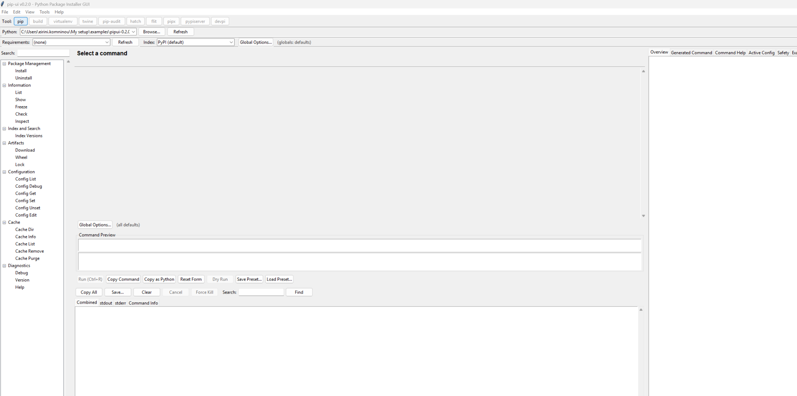

# Bundlr 📦

Bundlr turns a pinned PyPI requirement or HTTPS Git project into a self-contained
Python application for Linux x64, Windows x64, or macOS ARM64/x64. Recipients need
only the generated application. They do not need Python, Jac, Bun, uv, or Bundlr.

Bundlr's CLI, packaging engine and browser behavior are authored in
[Jac](https://jaclang.org). The CLI compiles to native machine code. Its portable
release includes native libraries, browser assets, a CA bundle and a compressed,
checksum-pinned `uv` executable. Keep the entire extracted release directory together.

## Use Bundlr

Download the archive for your **builder** platform, verify its `.sha256` file, and
extract it. Run `bundlr` (`bundlr.exe` on Windows) with no arguments to open the
local browser interface. Use **Quit Bundlr** to stop it; closing the last page
also stops the server after a short grace period.

From a terminal:

```sh
./bundlr --diagnose
./bundlr --command black --target all "black==26.5.1"
./bundlr --name PipUI --command pip-ui --kind windowed \
  --target windows-x86_64 --output dist/pipui-0.2.0 "pip-ui-tkinter==0.2.0"
./bundlr --target all \
  https://github.com/example/example-app.git@0123456789abcdef0123456789abcdef01234567
```

PyPI sources must use an exact version, optionally with extras:
`name[extra]==1.2.3`. Ranges, wildcards, local paths and HTTP Git URLs are rejected.
Git sources may include `git+`, `@revision` and `#subdirectory=...`. Use a full
commit for reproducible Git inputs. Git builds require system Git and can execute
the project's build backend on the controlled builder.

Bundlr detects the application name, entry point and console/GUI type when possible.
When several commands exist, it prefers a unique command matching the requested
distribution's name (ignoring case and normalizing `.`, `_` and `-`). For example,
`black==26.10.1` defaults to `black`; `--command blackd` selects the daemon instead.
Use `--name`, `--command` and `--kind` to resolve ambiguity. Options precede the
single source. `bundlr package ...` remains an alias. `--help` lists all options.
Python 3.12 / 3.12.13 is supported. Repeat `--target`, or select `all`.

Each target produces an application directory, a client archive and its checksum:

| Target | Application launcher | Client archive |
| --- | --- | --- |
| Linux x64 | `Name-linux-x86_64/Name` | `.tar.gz` |
| Windows x64 | `Name-windows-x86_64/Name.exe` | `.zip` |
| macOS ARM64 | `Name-macos-arm64.app` | `.tar.gz` |
| macOS x64 | `Name-macos-x86_64.app` | `.tar.gz` |

Extract the entire application before launching it. Copying just its launcher is
insufficient. Bundlr refuses to overwrite a completed directory, archive or
checksum, including when two builds race. Use a new versioned output directory.
On Windows builders, send the generated archives for Unix targets: Bundlr retains
Unix runtime permissions and symbolic links in archive metadata independently of
the Windows filesystem. Copying the Windows-staged directory cannot preserve them.
For these archives, installed package assets receive execute permission so wheels
that contain helper executables remain usable; their read/write permissions do not
change. Runtime files retain their original Unix permissions.

## Verify and support generated applications

Keep an archive and its `.sha256` file together. On Linux use
`sha256sum --check Name-windows-x86_64.zip.sha256`; on macOS use
`shasum -a 256 --check Name-windows-x86_64.zip.sha256`.

On Windows PowerShell:

```powershell
$archive = ".\Name-windows-x86_64.zip"
$expected = ((Get-Content "$archive.sha256" -Raw).Trim() -split "\s+")[0]
if ((Get-FileHash $archive -Algorithm SHA256).Hash -ine $expected) {
    throw "SHA-256 verification failed"
}
```

Evidence is at the application root, or `Contents/Resources` inside a macOS app:

- `bundlr-manifest.json`: format version, application identity, source, selected
  entry point, target, Python version and Bundlr version.
- `bundlr-dependencies.json`: installed distribution names and versions.
- `THIRD_PARTY_LICENSES.txt`: collected runtime and distribution licence notices.
- `SHA256SUMS`: sorted hashes of regular files relative to that evidence directory,
  excluding `SHA256SUMS` itself. The external archive checksum covers the full app.

These files document a build; they are not signatures, vulnerability assessments
or a complete software bill of materials. Use [IT_SUPPORT_REPORT.md](IT_SUPPORT_REPORT.md)
for deployment evidence and clean-device acceptance.

Bundlr combines checksum-pinned
[python-build-standalone](https://github.com/astral-sh/python-build-standalone)
runtimes with target-compatible wheels selected by [uv](https://docs.astral.sh/uv/).
It prohibits source builds for target dependencies. A Git root wheel must be pure
Python with only portable tags before dependencies are installed for the target.
Foreign target executables are never run during packaging. Launchers use bundled
Python with `-I -B` and do not use the builder's Python.

The browser server binds only to `127.0.0.1` on a random port. It checks Host,
mutation tokens and browser Origin, and permits one active build. CLI and browser
share the same streamed, cancellable packaging engine.
Windows builds use the included `bundlr-child.exe` runner and a per-build Job
Object to stop the complete build process tree before cleaning staging.

## Release size and cache

Both the native executable and **complete compressed release** must be below
50 MiB (52,428,800 bytes). A build fails before publication if either limit is hit.
Every release includes a `.size.json` report with executable, full archive,
unpacked, native-library and compressed/expanded uv sizes.

The local Linux development build measured about 2 MiB for the executable and
24 MiB for its archive, including compressed uv. Its system libraries do not prove
production portability or production size. CI builds the pinned dependency closure
and enforces the same limit on all four releases. Expanded uv is about 57 MiB and
is cached on first use; it is verified again before each execution.

Default caches are `$XDG_CACHE_HOME/bundlr/runtime` (or `~/.cache/bundlr/runtime`)
on Linux, `~/Library/Caches/bundlr/runtime` on macOS, and
`%LOCALAPPDATA%/Bundlr/runtime` on Windows. `BUNDLR_CACHE_DIRECTORY` overrides the
cache root. `BUNDLR_UV_EXECUTABLE` accepts only an executable matching the compiled
host checksum. `BUNDLR_CA_BUNDLE` can select an organization CA bundle for Bundlr's
HTTPS downloads. uv uses its own documented certificate/proxy configuration.

## Development

Use Jac **0.39.0**, CMake 3.25+, a native C toolchain, Git and the platform SDK.
Linux builds also require `patchelf`, autotools and Ninja. Install the pinned Jac
version using the [official installer](https://jaclang.org/docs/latest/quick-guide/install).
Application source and developer helpers are Jac; helpers run in the developer's
Jac environment, while released Bundlr contains no Jac interpreter or Python runtime.

From the repository root:

```sh
jac run scripts/prepare_uv.jac --target linux-x86_64
jac fmt --check src scripts tests ui
jac check src scripts tests ui --lint
jac check src scripts tests ui
jac run scripts/build.jac
jac run scripts/test.jac --native-libs .build/native/linux-x86_64/portable-libs
dist/bundlr-linux-x86_64/bundlr --diagnose
jac run scripts/smoke.jac --runtime dist/bundlr-linux-x86_64 --browser
.build/tests/acceptance-test builder dist/bundlr-linux-x86_64/bundlr .build/acceptance
```

Use the host target for `prepare_uv`. `build.jac` defaults to the host and creates
`dist/bundlr-TARGET/`, its archive, checksum and size report. It clones vcpkg into
`.build/`, checks out the immutable baseline in `build-lock.json`, builds libraries
using `vcpkg.json` and the custom triplets, then verifies and compresses pinned uv.
Native builds reject Python fallback. No registry JavaScript dependencies are needed.

`--native-libs PATH --target TARGET` consumes a dependency bundle produced on that
target. Its target, baseline and hashes must match. This permits Windows native
cross-compilation from Linux. The dependency bundle must preserve relative symlinks.
macOS releases compile on an ARM Mac using Jac 0.39.0. The Intel release uses
`--target-triple x86_64-apple-darwin` and libraries built on Intel macOS; both Mac
architectures retain the library-path audit. Native acceptance runs on each target
architecture, including Intel macOS, without requiring a Jac compiler there.

`--development-libs PATH` permits local shared libraries for diagnosis. Its outputs
are named `bundlr-dev-*` and are never release evidence. `--prepared-uv` reuses
previously prepared bytes after SHA-256 verification. Generated output stays ignored.

Tests compile to native executables to exercise the release ABI, filesystem,
archives, processes, HTTP parser and state machine. `scripts/smoke.jac` also checks
uv cache repair, invalid tool rejection and live loopback controls. `--browser`
requires Chrome and uses Jac's browser tooling for validation, cancellation and a
real packaging flow. Hosted Jac tests are not used for the native FFI boundary.

GitHub Actions checks source, builds pinned dependencies and portable releases for
four hosts, runs target-host contract tests and Linux-to-target Black acceptance,
and publishes archives/checksums/size reports for `v*` tags only after smoke tests.
Every host must also package and run pinned Black and a Git fixture through the
released CLI. Git tests use committed local repositories and a test-scoped HTTPS
URL rewrite; they exercise Git, PEP 517, target dependency markers and rejection
of a nonportable root wheel without relying on a mutable external project.
Windows additionally runs a real Tk GUI through `pythonw.exe`, with builder tools
removed from the recipient's PATH, and packages all four targets. Separate Linux
and macOS jobs extract the Windows-built archives with the host's `tar` and launch
both applications. These jobs need no Jac installation on recipient runners.

The **Production readiness (all four hosts)** check fails if any build or
acceptance matrix fails, is skipped or is cancelled; publishing requires that
check to succeed. Require that same status in repository branch protection to
gate merges as well as releases.

Windows and macOS runtime checks, the production dependency closure and real browser
acceptance have not been run in the current restricted Linux workspace.

Earlier packaging pipelines successfully delivered PipUI 0.2.0 and Black 26.5.1 to
a Windows machine without Python. That historical evidence has not yet been repeated
on a clean device for this Jac rewrite:


